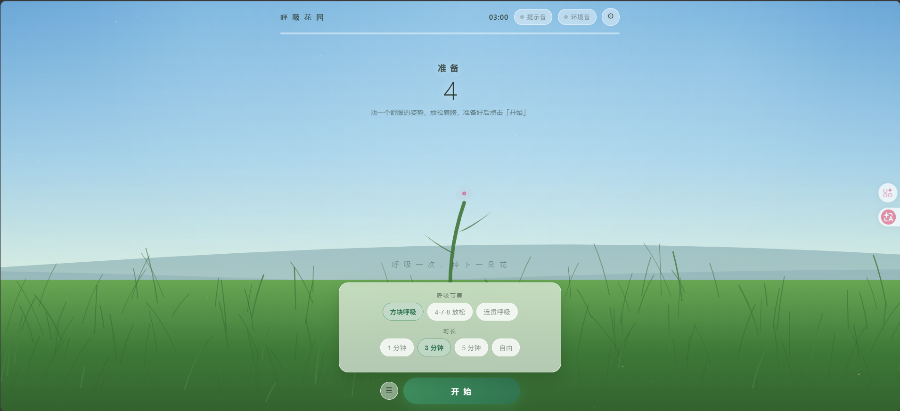

# 呼吸花园 · Breathing Garden

跟着一朵花形「呼吸口」练习呼吸。每完成一次呼吸循环，草地上就破土长出一朵小花。



三种节奏、四档时长、四个天光主题，手碟音色的阶段提示音与环境风声。
花园是**会话级**的——刷新即归零，不做任何持久化、不联网、不申请多余权限。

网页版和安卓版都在这个仓库里：

| 版本 | 文件 | 说明 |
|---|---|---|
| 网页版 | [`breathing-garden.html`](breathing-garden.html) | 单文件、素材内嵌、可离线，双击即开 |
| 安卓版 | [`breathing-garden.apk`](breathing-garden.apk) | 由同一个 HTML 打包，可直接侧载 |

---

## 特性

- **花形呼吸口**：吸气花苞膨胀、屏息轻微脉动、呼气花瓣外展、空屏回落
- **种花**：每完成一次呼吸，地面上长出一朵小花；花朵数量、大小、疏密自动适配屏幕
- **三种节奏**：方块呼吸 4-4-4-4、4-7-8 放松、连贯呼吸 5-5
- **四档时长**：1 / 3 / 5 分钟，或「自由」
- **四个天光**：晴日、晨光、黄昏、月夜，配色与地平线随之切换
- **手碟提示音**：四个阶段四种音型，仅阶段开始时敲一声
- **环境风声**：默认关闭，音量低于提示音
- **息屏可继续**：安卓版息屏后提示音照常响，回到前台自动追平进度

---

## 快速开始

### 网页版

直接双击 `breathing-garden.html`。手机端竖屏 / 横屏都已适配。

也可以把它挂到任意静态托管（GitHub Pages 等）当作 PWA 安装：浏览器只允许在
**HTTPS**（或 localhost）下安装 PWA，`file://` 打开时无法安装。

### 安卓版

```bash
adb install -r breathing-garden.apk
```

或把 APK 传到手机上手动安装（需允许「安装未知来源应用」）。
当前 APK 是 **debug 签名**，只适合自己安装，不能直接上架应用商店。

---

## 呼吸节奏

| 节奏 | 阶段 | 用途 |
|---|---|---|
| 方块呼吸 | 吸气 4 · 屏息 4 · 呼气 4 · 屏息 4 | 稳定节律，适合日常放松 |
| 4-7-8 放松 | 吸气 4 · 屏息 7 · 呼气 8 | 睡前放松 |
| 连贯呼吸 | 吸气 5 · 呼气 5 | 无屏息，适合刚开始练习 |

---

## 音效

提示音是一只手碟，用加性合成实时算出 PCM，不引入任何采样文件：

| 阶段 | 音型 | 听感 |
|---|---|---|
| 吸气 | C4 → G4 → C5 上行 | 打开、向上 |
| 屏息 | C5 + G5 纯五度 | 悬停、开阔 |
| 呼气 | C5 → G4 → C4 下行 | 释放、下落 |
| 空屏 | C3 + G3 低音 | 落地、安静 |
| 呼吸完成 | C6-D6-G6 三连音 | 开花（很轻） |
| 会话结束 | C 大调琶音 | 收束 |

每个阶段只在开始时敲一声，余音自然衰减，留出呼吸间隙；不是持续垫音。
音高、长度、衰减都集中在 `breathing-garden.html` 的 `HANDPAN` 与 `CUE_DEFS` 里。

想先听再改：`sound-preview/finalize.js` 会用应用里**完全相同的合成函数**导出 WAV。

```bash
cd sound-preview && node finalize.js   # 输出到 sound-preview/final/
```

`generate.js` 是早期对比四种乐器（手碟 / 卡林巴 / 马林巴 / 颂钵）的脚本。

---

## 从源码构建 APK

工程用 Capacitor 包一层 WebView，源文件就是仓库根目录的那个 HTML。

需要：JDK 21、Android SDK、Node.js。

```bash
cp build.env.example build.env   # 填入 JAVA_HOME / ANDROID_HOME
./build-apk.sh
```

`build.env` 已被 gitignore，不会提交。也可以直接用同名环境变量：

| 变量 | 作用 |
|---|---|
| `JAVA_HOME` | JDK 21 |
| `ANDROID_HOME` | Android SDK |
| `GRADLE_USER_HOME` | 可选，Gradle 缓存目录 |
| `GRADLE_DIST_URL` | 可选，Java 访问不了 `services.gradle.org` 时指向本地 gradle 分发包 |

构建脚本会先把 HTML / PWA 文件同步到 `capacitor/www/`，再跑 `cap sync` 和
`gradlew assembleDebug`，最后把产物复制成根目录的 `breathing-garden.apk`。

### 换成正式签名（上架用）

```bash
keytool -genkey -v -keystore release.keystore -alias bg -keyalg RSA -keysize 2048 -validity 10000
# 在 capacitor/android/app/build.gradle 里配置 signingConfigs，再跑 assembleRelease
```

---

## 素材流水线

背景与花朵是生图素材，已经 base64 内嵌进最终 HTML；平时改代码不需要跑这些脚本。

```
tools/gen_images.py      调生图 API 生成 10 张原图        -> source/
tools/prep_sprites.py    白底抠图 / 裁剪 / 缩放           -> assets/*-sprite.png
tools/embed_assets.py    压缩 + base64 内嵌               -> 写回 breathing-garden.html
tools/icon.html          图标源文件（浏览器打开截图即得 512px 图标）
```

`gen_images.py` 读取环境变量 `RIGHTAPI_KEY`（或 `tools/.env`，该文件不提交）。
`embed_assets.py` 顶部可调 `BG_QUALITY` / `BG_MAXW` / `SPRITE_MAXH` 控制成品体积。

---

## 技术说明

### 息屏后提示音为什么还在

这是安卓版最容易踩的坑，也是本项目的核心实现：

- 环境风声是一个**已启动的循环音源**，由音频线程播放，息屏后本来就在响
- 旧做法是在 `requestAnimationFrame` 推进阶段时**临时创建**振荡器。息屏后 WebView
  停止渲染帧、定时器被降频，阶段不再推进，提示音自然消失
- 现在改成在「开始」时把**整段会话的提示音一次性排程**到 `AudioContext` 时间轴上
  （`start(when)`），不依赖任何 JS 回调；回到前台再按 `performance.now()` 把阶段、
  倒计时和花一次追平
- 安卓壳在会话进行中持有 **partial wake lock**（`WAKE_LOCK`），暂停 / 结束即释放，
  避免 CPU 深睡把音频线程一起挂起

### 其它

- 会话时钟以 `performance.now()` 为锚，而不是逐帧累加 `dt`，所以息屏回来不会漂移
- 呼吸次数按「呼气结束」计数；息屏跨过的多次呼吸会补算，但一次最多补种 8 朵花
- `100dvh` 跟随地址栏收放，后备缓冲按实测盒子尺寸取（比 `innerHeight` 可靠）
- 顶栏在 `<560px` 整体收窄；`<520px` 高（横屏）另有一套紧凑布局
- 花朵上限随屏宽伸缩（`W/14`，24–80），缩屏时裁掉超出的花，避免挤成一团
- 触摸热区 ≥ 32px；`overscroll-behavior:none` 禁掉下拉刷新，免得误触打断呼吸

---

## 文件结构

```
breathing-garden.html      应用本体（素材内嵌，单文件可分发）
breathing-garden.apk       安卓安装包
manifest.webmanifest       PWA 清单
sw.js                      Service Worker
icon-192.png / icon-512.png
screenshot.png
build-apk.sh               打包脚本
build.env.example          打包脚本的机器配置模板
assets/                    构建素材（背景 + 花朵精灵），运行时不需要
source/                    生图原图（白底），供重新抠图
tools/                     素材构建脚本
sound-preview/             音色试听脚本与导出结果
capacitor/                 Capacitor 原生工程（可重新打包）
```

---

## 已知取舍

- 花与背景是生图素材，体积换观感：内嵌后 HTML 约 1 MB
- 呼吸口颜色固定不变——早期版本每轮换色，会分散注意力
- 提示音需要用户手势后才会响（浏览器自动播放策略），所以默认关闭
- 息屏保底用的是 partial wake lock，不是前台服务。正常几分钟的练习足够；
  若系统在后台强杀 WebView，或某些厂商的激进省电策略连音频一起挂起，长会话仍可能中断。
  要「硬保证」需要加 `mediaPlayback` 前台服务，代价是多一条常驻通知
- 花园不持久化：刷新、关闭页面即归零

---

## License

[MIT](LICENSE)
